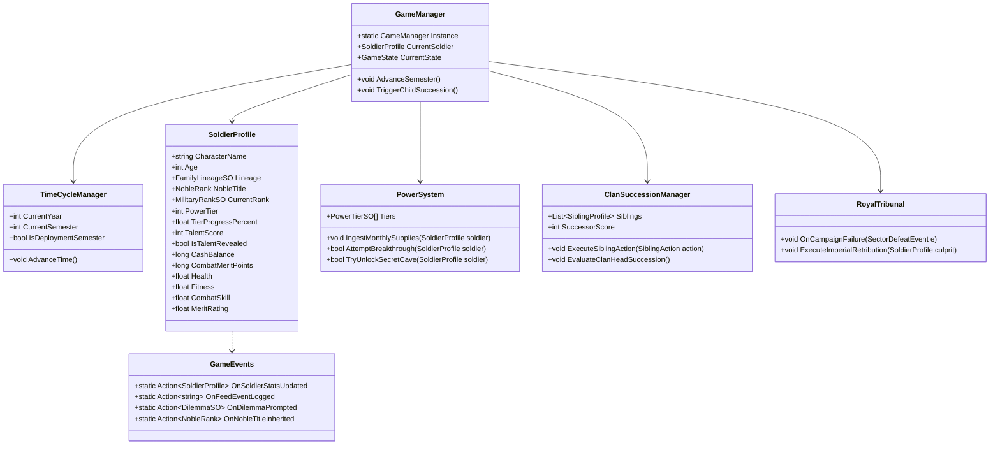

# C# Software Architecture & Class Reference Manual

> **Framework**: Unity 6 (6000.4.1f1) / C# .NET Standard 2.1  
> **Pattern**: Model-View-Presenter (MVP) with ScriptableObject Data-Driven Engine & Event-Bus Decoupling.

---

## 1. Class Diagram Architecture



---

## 2. Core Data Models & ScriptableObjects

### `PowerTierSO.cs`
Defines the 12 Power Tiers, lifespan, stat modifiers, and knowledge restrictions.
```csharp
using UnityEngine;

namespace ArmyLife.Data
{
    public enum TierStratum
    {
        MortalInitiate,     // Tiers 1-3
        MortalPeak,         // Tiers 4-6 (Spoken Limit)
        NationalGuardian,   // Tiers 7-10 (Elite dynasties only)
        PrimordialSect      // Tiers 11-12 (Hidden Realms: 500 & 1,000 yrs)
    }

    [CreateAssetMenu(fileName = "PowerTier_", menuName = "ArmyLife/Power Tier")]
    public class PowerTierSO : ScriptableObject
    {
        public int tierLevel;               // 1 to 12
        public string designation;          // e.g., "Silver Centurion", "Primordial Immortal"
        public TierStratum stratum;
        public int maxLifespanYears;        // e.g., 85, 140, 350, 500, 1000
        public int monthlySalaryBonus;      // tierLevel * $750
        public float breakthroughDifficulty; // 0.0 to 1.0
        public bool isHiddenFromPublic;
        public bool isHiddenFromTopHouses;  // True for Tiers 11 and 12
    }
}
```

---

### `MilitaryRankSO.cs`
Defines military paygrades, base salaries, clearance levels, and promotion requirements.
```csharp
using UnityEngine;

namespace ArmyLife.Data
{
    public enum PaygradeType
    {
        Enlisted,   // E-1 to E-9
        Warrant,    // WO-1 to CW-5
        Officer     // O-1 to O-10
    }

    [CreateAssetMenu(fileName = "Rank_", menuName = "ArmyLife/Military Rank")]
    public class MilitaryRankSO : ScriptableObject
    {
        public string rankName;             // e.g., "Private", "Corporal", "Captain"
        public string paygrade;             // e.g., "E-1", "E-4", "E-8", "O-6"
        public PaygradeType type;
        public int baseMonthlySalary;       // e.g., $1,800, $2,700, $5,300, $10,500
        public int requiredMeritPoints;
        public int requiredFitness;
        public Sprite insigniaIcon;
        
        // Special Clearance Privileges
        public bool unlocksSelfTalentTesting;   // True for E-4 (Corporal/Specialist)
        public bool unlocksFamilyTalentTesting; // True for E-8 (Master Sergeant)
    }
}
```

---

### `NobleRank.cs`
```csharp
namespace ArmyLife.Data
{
    public enum NobleRank
    {
        Commoner = 0,
        Baron = 1,          // Battalion/Company level
        Viscount = 2,
        Count = 3,          // Regiment level
        Marquis = 4,        // Division level
        GrandDuke = 5,      // Corps level - Attends Royal Court
        RoyalClan = 6       // Imperial Sovereigns
    }
}
```

---

## 3. Manager Implementations

### `TalentTestingApparatus.cs`
Handles the military resonance chamber clearance and rolls.
```csharp
using UnityEngine;

namespace ArmyLife.Systems
{
    public static class TalentTestingApparatus
    {
        public static bool CanTestSelf(SoldierProfile soldier)
        {
            if (soldier.NobleTitle > NobleRank.Commoner) return true; // Noble birth privilege
            return soldier.CurrentRank.unlocksSelfTalentTesting;       // E-4 check
        }

        public static bool CanTestFamily(SoldierProfile soldier)
        {
            if (soldier.NobleTitle > NobleRank.Commoner) return true;
            return soldier.CurrentRank.unlocksFamilyTalentTesting;     // E-8 check
        }

        public static int RollGeneticChildTalent(int fatherTalent, int motherTalent)
        {
            float average = (fatherTalent + motherTalent) / 2f;
            float roll = Random.Range(0f, 100f);

            if (roll < 7.5f)
            {
                // Heavenly Atavism (Super Mutation): +40 to +70 spike
                int atavism = Mathf.RoundToInt(average + Random.Range(40, 71));
                return Mathf.Clamp(atavism, 0, 200);
            }
            else if (roll < 15.0f)
            {
                // Meridian Degeneration: -40 to -70 collapse
                int drop = Mathf.RoundToInt(average - Random.Range(40, 71));
                return Mathf.Clamp(drop, 0, 200);
            }
            else if (roll < 30.0f)
            {
                // Moderate Shift: +/- 20
                return Mathf.Clamp(Mathf.RoundToInt(average + Random.Range(-20, 21)), 0, 200);
            }
            else
            {
                // Standard Inheritance (70%): +/- 10
                return Mathf.Clamp(Mathf.RoundToInt(average + Random.Range(-10, 11)), 0, 200);
            }
        }
    }
}
```

---

### `SalaryCalculator.cs`
Calculates dynamic monthly pay including tech school graduate stipends.
```csharp
namespace ArmyLife.Systems
{
    public static class SalaryCalculator
    {
        public static long CalculateMonthlyPay(SoldierProfile s)
        {
            long total = s.CurrentRank.baseMonthlySalary;

            // Power Tier Stipend ($750 per tier)
            total += (s.PowerTier * 750);

            // Noble Title Aristocratic Allowance
            switch (s.NobleTitle)
            {
                case NobleRank.Baron:     total += 2000; break;
                case NobleRank.Viscount:  total += 3500; break;
                case NobleRank.Count:     total += 5000; break;
                case NobleRank.Marquis:   total += 10000; break;
                case NobleRank.GrandDuke: total += 25000; break;
            }

            // Tech School Graduate Specialist Allowance (Guaranteed for Tech Passouts)
            if (s.IsTechnicalSchoolGraduate)
            {
                total += 450; // Tech stipend
                total += 350; // Cyber allowance
            }

            // High Merit Bonus
            if (s.MeritRating >= 90f) total += 1000;
            else if (s.MeritRating >= 75f) total += 400;

            // Hazardous Deployment Pay
            if (s.IsInCombatDeployment) total += 450;

            return total;
        }
    }
}
```

---

### `SecretAncientSectCave.cs`
Controls the 1-in-100 special mission anomaly and Tier 11/12 unlock conditions.
```csharp
using UnityEngine;

namespace ArmyLife.Systems
{
    public class SecretAncientSectCave : MonoBehaviour
    {
        public static bool CheckEntryEligibility(SoldierProfile soldier)
        {
            // Hidden Condition 1: Must be Tier 10
            if (soldier.PowerTier < 10) return false;

            // Hidden Condition 2: Talent must be 180 or higher
            if (soldier.TalentScore < 180) return false;

            // Hidden Condition 3: Foundation must be uncorrupted (no black-market shortcuts)
            if (soldier.HasCorruptedFoundation) return false;

            return true;
        }

        public static void GrantPrimordialInheritance(SoldierProfile soldier)
        {
            soldier.HasDiscoveredSecretCave = true;
            soldier.UnlockedTiers11And12 = true;
            
            GameEvents.OnFeedEventLogged?.Invoke(
                "<color=#FFD700><b>[PRIMORDIAL REVELATION]</b></color> You breached the Spirit Array of the Ancient Cultivation Sect! " +
                "The forgotten truth of Tiers XI (500 Years) and XII (1,000 Years) has been etched into your consciousness!"
            );
        }
    }
}
```

---

## 4. UI Architecture & Decoupled Event System

The UI never directly polls or modifies data classes. All updates flow through **`GameEvents`**:

```csharp
using System;
using ArmyLife.Data;

namespace ArmyLife.Core
{
    public static class GameEvents
    {
        // State updates
        public static Action<SoldierProfile> OnSoldierStatsUpdated;
        public static Action<int, int> OnSemesterAdvanced; // (Year, Semester)
        
        // Feed & Dialogs
        public static Action<string, string> OnFeedEventLogged; // (Category, Message)
        public static Action<DilemmaData> OnDilemmaPrompted;
        
        // Milestones
        public static Action OnThreePromotionsReached; // Triggers Arranged Marriage
        public static Action OnChildBorn;              // Triggers Soul Transfer Prompt
        public static Action<NobleRank> OnNobleTitleInherited;
        public static Action OnImperialExecutionTriggered;
    }
}
```
