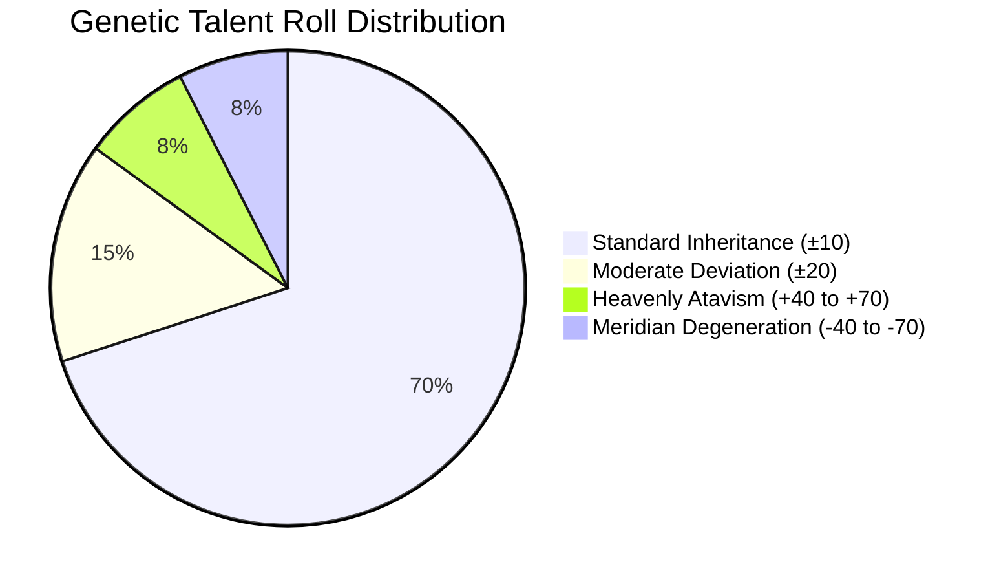

# Data Dictionary & Formulas Manual

> Complete lookup tables, mathematical equations, and balance parameters for **Army Life Simulator**.

---

## 1. Ranks, Paygrades & Clearance Matrix

| Paygrade | Rank Title | Base Salary | Self Talent Testing | Family Talent Testing | Promotion Points Needed |
| :---: | :--- | :---: | :---: | :---: | :---: |
| **E-1** | Private Recruit | $1,800 / mo | ❌ Locked | ❌ Locked | Starting Rank |
| **E-2** | Private Second Class | $2,050 / mo | ❌ Locked | ❌ Locked | 150 Points |
| **E-3** | Private First Class | $2,300 / mo | ❌ Locked | ❌ Locked | 300 Points |
| **E-3 (Tech)**| **Technical Specialist** | **$3,150 / mo** | ❌ Locked | ❌ Locked | **Graduate Passout** |
| **E-4** | **Corporal / Specialist** | **$2,700 / mo** | **✅ UNLOCKED** | ❌ Locked | 500 Points |
| **E-5** | Sergeant | $3,200 / mo | ✅ Unlocked | ❌ Locked | 750 Points |
| **E-6** | Staff Sergeant | $3,750 / mo | ✅ Unlocked | ❌ Locked | 1,050 Points |
| **E-7** | Sergeant First Class | $4,400 / mo | ✅ Unlocked | ❌ Locked | 1,400 Points |
| **E-8** | **Master Sergeant / 1st Sgt** | **$5,300 / mo** | ✅ Unlocked | **✅ UNLOCKED** | 1,800 Points |
| **E-9** | Command Sergeant Major | $6,400 / mo | ✅ Unlocked | ✅ Unlocked | 2,300 Points |
| **O-1** | 2nd Lieutenant | $3,800 / mo | ✅ Unlocked | ❌ Locked | Academy Commission |
| **O-2** | 1st Lieutenant | $4,700 / mo | ✅ Unlocked | ❌ Locked | 600 Points |
| **O-3** | Captain | $6,200 / mo | ✅ Unlocked | ❌ Locked | 1,100 Points |
| **O-4** | Major | $7,400 / mo | ✅ Unlocked | ✅ Unlocked | 1,700 Points |
| **O-5** | Lieutenant Colonel | $8,800 / mo | ✅ Unlocked | ✅ Unlocked | 2,400 Points |
| **O-6** | Colonel | $10,500 / mo | ✅ Unlocked | ✅ Unlocked | 3,200 Points |
| **O-7** | Brigadier General | $12,500 / mo | ✅ Unlocked | ✅ Unlocked | 4,200 Points |
| **O-8** | Major General | $14,000 / mo | ✅ Unlocked | ✅ Unlocked | 5,500 Points |
| **O-9** | Lieutenant General | $16,000 / mo | ✅ Unlocked | ✅ Unlocked | 7,000 Points |
| **O-10**| General / Guardian Pillar | $18,000 / mo | ✅ Unlocked | ✅ Unlocked | 9,000 Points |

---

## 2. The 12-Tier Power System & Lifespan Progression

| Tier | Stratum | Designation | Monthly Resource Burn | Lifespan | Monthly Pay Bonus | Knowledge Access |
| :---: | :--- | :--- | :--- | :---: | :---: | :--- |
| **0** | Baseline | Civilian / Untrained Grunt | $0 | 75 Years | +$0 | Public |
| **1** | Mortal Initiate | Iron Initiate | $200 or 50 CMP | 85 Years | +$750 | Public |
| **2** | Mortal Initiate | Bronze Vanguard | $450 or 120 CMP | 90 Years | +$1,500 | Public |
| **3** | Mortal Initiate | Silver Centurion | $800 or 250 CMP | 95 Years | +$2,250 | Public |
| **4** | Mortal Peak | Gold Striker | $1,500 or 500 CMP | 115 Years | +$3,000 | Public |
| **5** | Mortal Peak | Obsidian Champion | $2,800 or 1,000 CMP | 125 Years | +$3,750 | Public |
| **6** | Mortal Peak | Peak Grandmaster | $4,500 or 1,800 CMP | 140 Years | +$4,500 | **Public Peak Limit** |
| **7** | National Guardian | Astral Guardian | $8,000 or 3,500 CMP | 220 Years | +$5,250 | Top Dynasties & High Command |
| **8** | National Guardian | Dreadnought Warlord | $14,000 or 6,000 CMP | 260 Years | +$6,000 | Top Dynasties & High Command |
| **9** | National Guardian | Sovereign Pillar | $22,000 or 10,000 CMP | 300 Years | +$6,750 | Top Dynasties & High Command |
| **10** | National Guardian | Supreme Guardian | $35,000 or 18,000 CMP | 350 Years | +$7,500 | **Top House Known Limit** |
| **11** | Primordial Sect | Primordial Immortal | Ancient Ley-Line Qi | **500 Years** | +$10,000 | **Secret Cave Only** |
| **12** | Primordial Sect | Apex Divinity | Primordial Core Essence | **1,000 Years** | +$20,000 | **Millennium Patriarch** |

---

## 3. The 200-Point Talent Distribution & Probabilities

$$\text{Parental Base} = \frac{\text{Father Talent} + \text{Mother Talent}}{2}$$

### Talent Multipliers:
- **0–49 (Marrowless)**: $\times 0.40$ resource absorption speed.
- **50–99 (Standard)**: $\times 1.00$ baseline speed.
- **100–149 (Prodigy)**: $\times 1.60$ absorption speed.
- **150–179 (Guardian Seed)**: $\times 2.30$ absorption speed.
- **180–200 (Heavenly Transcendent)**: $\times 3.50$ absorption speed (eligible for Secret Cave).

---

## 4. The 4 Exam Subject Tracks (Semester Study Allocation)

$$\text{Final Exam Score} = \frac{\text{Combat} + \text{Tech} + \text{Medical} + \text{Power}}{4}$$

| Exam Cutoff | Outcome Track | Graduate Rank & Pay |
| :---: | :--- | :--- |
| **98+ & Top 0.5%** | **Secret Branch Directorate** | Starts as Classified Operative ($6,500/mo) |
| **90–97** | **Tier-1 War Academy (West Point)** | Commissioned 2nd Lieutenant (O-1) ($3,800/mo) |
| **75–89** | **Technical / Medical Academy** | **Specialist (E-3)** with Guaranteed Tech Stipend ($3,150/mo) |
| **50–74** | **Regional Combat School** | Private Second Class (E-2) ($2,050/mo) |
| **<50 or Skip** | **Direct Walk-In Enlistment** | Private (E-1) ($1,800/mo) |
