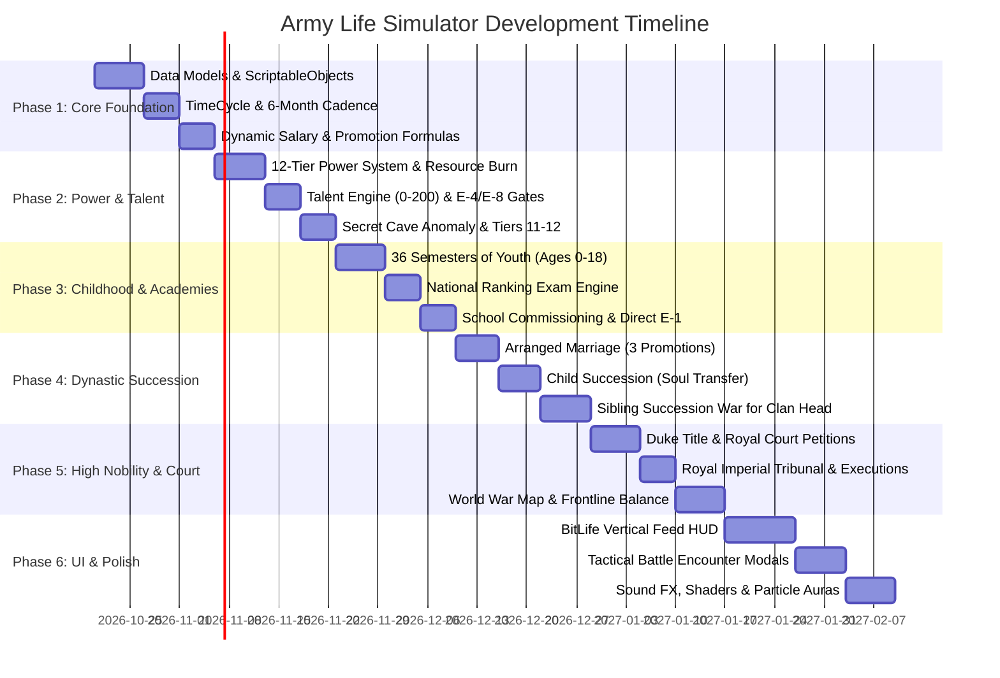

# Development Roadmap & Sprint Plan

> 6-Phase implementation roadmap for **Army Life Simulator** in Unity 6.

---

---

## Sprint Breakdown

### 🎯 Sprint 1: Data Models & Time Engine (Core)
- [ ] Create folder structure: `Assets/Scripts/{Core, Data, PowerSystem, Talent, Nobility, Academies, UI}`.
- [ ] Implement `PowerTierSO.cs` (12 tiers, lifespans: 500 yrs for T11, 1,000 yrs for T12).
- [ ] Implement `MilitaryRankSO.cs` (E-1 to E-9, O-1 to O-10, E-4/E-8 clearance flags).
- [ ] Implement `TimeCycleManager.cs` (2 semesters per year, alternates refit and deployment).
- [ ] Implement `SalaryCalculator.cs` (Rank base + tier bonuses + tech stipend + hazard pay).

### 🎯 Sprint 2: Power Progression & Talent System
- [ ] Implement `PowerSystem.cs` (Continuous monthly resource ingestion + breakthrough bottleneck checks).
- [ ] Implement `TalentTestingApparatus.cs` (Testing restrictions: Nobles at birth, Commoners at E-4, Family at E-8).
- [ ] Implement `GeneticEngine.cs` (70% standard, 15% shift, 7.5% atavism spike, 7.5% degeneration).
- [ ] Implement `SecretAncientSectCave.cs` (180+ talent check, pure foundation check, unlocking Tiers 11 & 12).

### 🎯 Sprint 3: Childhood (Ages 0–18) & National Exam
- [ ] Implement 36-semester youth loop with foundational body tempering (Bone, Meridian, Marrow, Resonance).
- [ ] Implement study hour allocation across Combat, Tech, Medical, and Power subjects.
- [ ] Implement `NationalExamEngine.cs` with score calculation and school assignment.
- [ ] Implement Tech School graduate rule (Guaranteed E-3 passout with higher pay).

### 🎯 Sprint 4: Family Lineage & Sibling Succession War
- [ ] Implement `SiblingSuccessionWar.cs` (Successor points, alliances, legal lobbying, sanctioned duels).
- [ ] Implement `MarriageManager.cs` (3 promotions $\rightarrow$ Arranged Marriage trigger).
- [ ] Implement `SuccessionManager.cs` (Soul transfer to newborn child vs play till death $\rightarrow$ reincarnate as youngest descendant).

### 🎯 Sprint 5: The Royal Court & Imperial Tribunal
- [ ] Implement `NobleTitleSystem.cs` (Inheriting Duke / Marquis title upon becoming Clan Head).
- [ ] Implement `RoyalCourtManager.cs` (Attending sessions with the Emperor, war campaign voting, energy well bidding).
- [ ] Implement `RoyalTribunal.cs` (Frontline sector loss checks $\rightarrow$ summary execution for treasonous negligence).

### 🎯 Sprint 6: BitLife-Style Canvas UI & Polish
- [ ] Build vertical mobile-first UI layout using Unity Canvas & TextMeshPro.
- [ ] Implement scrollable reverse-chronological event timeline (`FeedController.cs`).
- [ ] Implement multi-choice dilemma popups (`DilemmaModal.cs`).
- [ ] Add sound effects, rank insignia icons, and golden celestial aura shaders for Tier 11/12!
