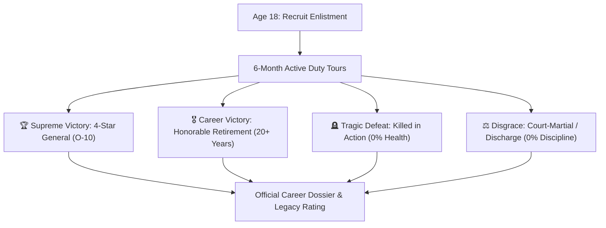
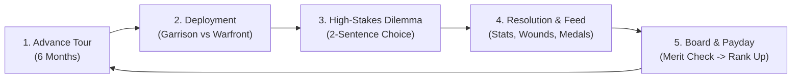

# Army Life Simulator - Game Design Document (GDD v5.0 Master Edition)

> **Core Focus:** Pure Military Life Simulation RPG (Option A)  
> **Comps:** *BitLife* meets *Band of Brothers*, *Papers, Please*, and *Reigns*.  
> **Target Audience:** Fans of career simulators, narrative dilemma games, and military history/fiction.  
> **Engine:** Unity 6 (URP 2D)  
> **Primary Philosophy:** Fast, punchy, high-stakes military drama with immediate playability and zero unnecessary bloat.

---

## 1. High Concept & Creative Vision

**Army Life Simulator** is an interactive, text-and-choice-driven military career simulator. The player enters active service on **Enlistment Day at Age 18**. 

Over semiannual 6-month deployment cycles, the player navigates the harsh realities of service: drilling at garrison bases, surviving harrowing frontline firefights, managing comrades and commanding officers, and balancing duty against survival.

Every choice carries immediate weight. Players can climb from a drafted **Private (E-1)** all the way to **4-Star General (O-10)**, survive decades to an **Honorable Retirement**, fall heroically in combat (**Killed in Action**), or end their career in disgrace (**Court-Martial**).

---

## 2. Core Design Pillars

1. **Immediate Action (Zero Slog)**: The game skips childhood entirely. You create your recruit and start at boot camp on turn 1.
2. **Every Choice Has Teeth**: Dilemmas present meaningful trade-offs (e.g., risk your life to rescue a squadmate, or protect your position; obey a reckless order, or use tactical initiative).
3. **Transparent Progression**: Ranks, medals, salary, and stats are always visible, intuitive, and satisfying to grow.
4. **Definitive Runs & High Replayability**: A single career takes 15–25 minutes, ending in a shareable **Career Dossier** summarizing your lifetime achievements.

---

## 3. End Points (Victory & Defeat Conditions)



### The 4 Endpoints

1. **The 4-Star General (Supreme Victory)**: Reaching rank O-10 (General of the Army). Leads national defense, enters the military hall of fame.
2. **The Honorable Veteran (Career Victory)**: Completing 20–30 years of active duty and retiring voluntarily with a full pension, decorations, and veteran respect.
3. **Killed in Action (KIA)**: Health drops to 0% during combat. Receives a military funeral, posthumous medals (e.g. Purple Heart / Imperial Star), and a memorial tribute.
4. **Court-Martial / Dishonorable Discharge**: Discipline drops to 0%, or caught committing mutiny, cowardice, or treason. Stripped of rank, medals, and benefits.

---

## 4. Character Creation (Age 18 Enlistment)

Players generate or customize their soldier with:
* **Name & Appearance**: Buzzcut, eye color, uniform styling.
* **Background Origin**:
  * *Farmhand*: +15% Health, +10% Fitness, humble beginnings.
  * *Street Tough*: +15% Combat Skill, -10% Starting Discipline, street smarts.
  * *Working-Class Mechanic*: +15% Intellect, bonus technical stipends.
  * *Military Family Legacy*: +15% Discipline, starting favor with NCOs.
* **Aptitude Roll**: Baseline stats (Health, Morale, Discipline, Combat Skill, Intellect).

---

## 5. The 5 Core Soldier Stats

```
+---------------------------------------------------------------+
|  HEALTH [100%]  |  MORALE [85%]  |  DISC [70%]  |  COMBAT [45%]|
+---------------------------------------------------------------+
```

1. **Health (0–100%)**: Physical integrity. Depleted by combat wounds, artillery concussions, or disease. 0% = KIA.
2. **Morale (0–100%)**: Psychological resolve. Depleted by prolonged trench warfare, loss of squadmates, or harsh punishments. Low morale causes panic or shell-shock.
3. **Discipline (0–100%)**: Military conduct and adherence to regulations. High discipline impresses commanders and enables officer candidacy (OCS). Low discipline leads to KP duty, brig time, and court-martial.
4. **Combat Skill (0–100%)**: Marksmanship, tactics, and reflex under fire. Decides success rates during frontline crises.
5. **Cash ($)**: Savings from monthly salary, hazardous combat stipends, and dice games. Spent on PX gear, medical treatment, or squad drinks.

---

## 6. The 6-Month Semiannual Tour Loop

Each turn represents 6 months (Spring/Summer Tour or Fall/Winter Tour):



1. **Deployment Evaluation**:
   * *Garrison Duty*: Weapons qualifications, barracks inspections, brawls, drill instructors, leave requests.
   * *Frontline Combat*: Pinned down by snipers, breaching machine gun nests, calling airstrikes, night trench patrols, rescuing wounded comrades.
2. **Dilemma Resolution**: 2–3 options with explicit risk/reward trade-offs.
3. **Log & Feed**: Real-time story text displayed in the BitLife-style vertical activity log.
4. **Promotion Board & Payday**: If Merit meets the promotion threshold and Discipline is acceptable, the player is promoted.

---

## 7. Rank Progression Ladder

### Enlisted Ranks
* **Recruit (E-1)** — Basic training ($150/mo)
* **Private (E-2)** — Line infantryman ($300/mo)
* **Private First Class (E-3)** — Experienced rifleman ($450/mo)
* **Corporal (E-4)** — Fireteam leader ($650/mo)
* **Sergeant (E-5)** — Squad leader ($900/mo)
* **Staff Sergeant (E-6)** — Platoon sergeant ($1,250/mo)
* **Master Sergeant (E-7)** — Senior non-commissioned officer ($1,800/mo)
* **Sergeant Major (E-9)** — Top enlisted authority ($2,600/mo)

### Officer Track (Commission via High Merit / OCS)
* **2nd Lieutenant (O-1)** — Platoon commander ($1,500/mo)
* **1st Lieutenant (O-2)** — Executive officer ($2,200/mo)
* **Captain (O-3)** — Company commander ($3,200/mo)
* **Major (O-4)** — Battalion operations officer ($4,800/mo)
* **Lieutenant Colonel (O-5)** — Battalion commander ($6,500/mo)
* **Colonel (O-6)** — Regimental commander ($9,000/mo)
* **Brigadier General (O-7)** — Brigade commander ($13,000/mo)
* **Major General (O-8)** — Division commander ($18,000/mo)
* **Lieutenant General (O-9)** — Corps commander ($25,000/mo)
* **General of the Army (O-10)** — Supreme Commander ($35,000/mo)

---

## 8. Military Medals & Ribbons

* 🩸 **Imperial Wound Star**: Surviving major wounds in combat.
* 🎯 **Combat Infantry Badge**: Surviving your first active frontline tour.
* 🌟 **Bronze Star of Valor**: Rescuing comrades under enemy fire.
* ⚔️ **Silver Vanguard Cross**: Single-handedly destroying an enemy strongpoint.
* 🛡️ **Distinguished Service Cross**: Holding the line against overwhelming odds.
* 🎖️ **Grand Imperial Star / Medal of Honor**: Highest decoration for legendary battlefield heroism.

---

## 9. After-Action Career Dossier (End Screen)

When the soldier retires, falls in battle, or is discharged, the **Career Dossier** displays:
* **Final Rank & Title** (e.g. *General Ethan Vance* or *Private First Class Logan Cross*)
* **Career Duration** (e.g. *Served 24 Years, 48 Tours of Duty*)
* **Battles & Fronts Survived**
* **Decorations Rack** (All ribbons and medals earned)
* **Final Cause of Conclusion** (*Retired with Honors*, *Killed in Action at Sector 7*, or *Dishonorably Discharged*)
* **Career Legacy Score** & High Scores Leaderboard.

---

## 10. The Imperial War Academy (2-Year Officer Program)

The Officer Academy offers a direct commission into the commissioned officer ranks (O-1+):
* **Duration**: Exactly **2 Years** (4 Semesters).
* **Admission Standards & Limited Seats**:
  * Admission is highly competitive with limited candidate seats per year.
  * Candidates must possess at least **55% Discipline / Tactics** and **55% Physical Readiness**.
  * A selection board scores candidate percentile (Legacy background provides a merit boost).
* **Tuition & Loan Financing**:
  * **Total Tuition**: **$50,000**.
  * **Upfront Cash Option**: Paid upfront if savings permit.
  * **Military Education Loan**: For cadets unable to afford $50,000 cash, an imperial education loan is approved at **9% annual interest** (4.5% accrued per 6-month semester).
  * **Salary Deduction**: Repaid via automatic monthly salary deduction. The player freely selects the deduction percentage (minimum **10%** of monthly salary; adjustable up to 50%).
* **Year 2 Special Forces Qualification**:
  * In **Year 2** (Semesters 3 & 4), cadets ranking in the **Top 10%** of their class (`academyPerformanceScore >= 90%`) receive an invitation to join the elite **1-Year Special Forces Qualification Course**.
* **Direct Commissioning**:
  * Upon passing out at Semester 4, the cadet is **directly commissioned as a 2nd Lieutenant (O-1)** with full company command authority and officer pay. Cadets in the top 10% graduate with High Honors and receive the *Imperial Honors Saber*.

---

## 11. Special Forces (Elite Covert Operations)

Special Forces operators represent the deadliest, most specialized branch of the armed forces:
* **Training Duration**: **1 Year** (2 Semesters of intensive qualification drills).
* **Two Entry Pathways**:
  1. **Academy Cadet Pathway**: Ranking in the **Top 10%** during Year 2 of the Imperial War Academy.
  2. **Enlisted Soldier Pathway**: Direct recommendation from the soldier's **Commanding Officer (CO)**. Requires high CO standing (`coFavor >= 70%`) and exemplary combat service (`meritRating >= 60%`).
* **Active Special Forces Perks & Risks**:
  * **Higher Pay**: Full operators draw an exclusive **+$800 / month Elite Hazard Stipend** on top of standard pay.
  * **Higher Fatality Risk**: Deployed on classified black-ops raids and deep-penetration missions behind enemy lines, carrying a significantly higher baseline casualty and KIA probability.
  * **Experience Scaling**: As the operator climbs through the ranks, their tactical experience multiplies:
    * Higher combat skill and merit gains per engagement.
    * Veteran command experience mitigates frontline mortality hazards.
    * Milestone decorations (Commando Ribbon, Silver Star with Valor, Legion of Merit).

---

## 12. Voluntary Extended Combat Tour & +10% Pay Bonus

Soldiers assigned to frontline deployment can volunteer to remain in active combat:
* **Voluntary Extension**: The player can volunteer to remain on the battlefield past the standard 6-month rotation instead of rotating back to base.
* **Standard Pay Continuity**: Base pay and standard hazard stipends continue during initial extension.
* **+10% Continuous Combat Veteran Bonus**:
  * If a soldier stays continuously deployed on the frontline for **longer than 1 year** (>= 2 consecutive semesters), their **Total Pay increases by 10%**.
  * This bonus stacks independently with all existing stipends and does not override or delay normal rank promotion raises.
