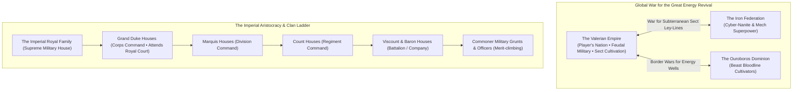
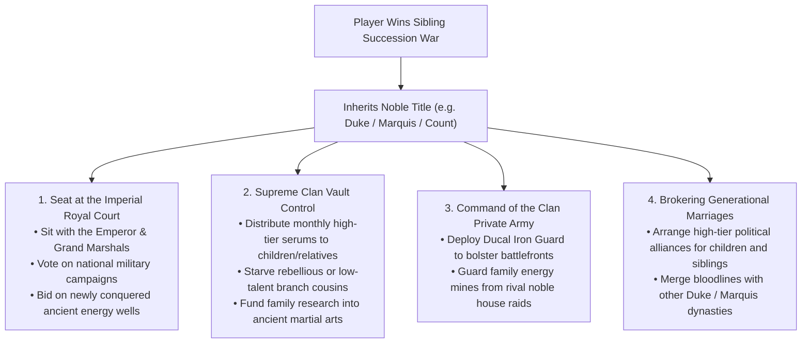
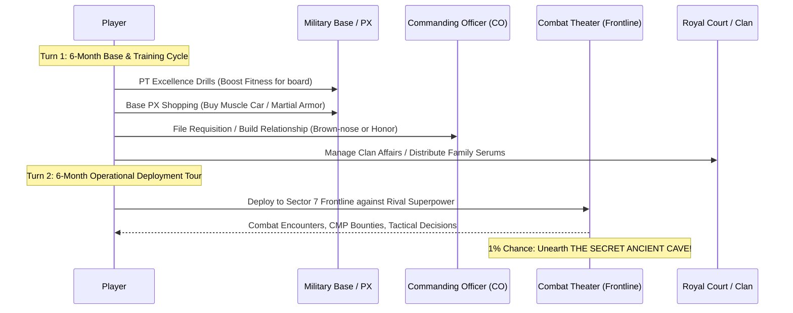
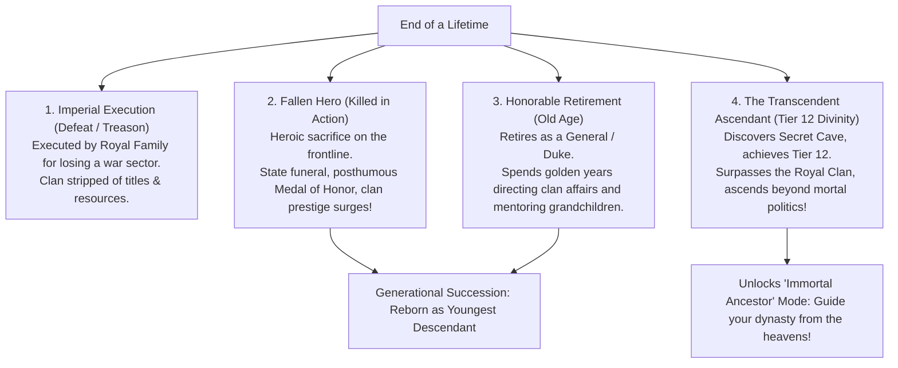

# Army Life Simulator - Game Design Document (GDD v4.0 Master Edition)
*The Era of Energy Revival: Feudal Military Dynasties, Royal Court, Clan Succession, 12-Tier Power Ladder & The World War*

---

## 1. High Concept & Setting Architecture

---

## 2. Becoming Clan Head: Noble Title Inheritance & The Royal Court

When a player wins the **Clan Succession War** against their siblings, they don the ceremonial mantle of the **Patriarch / Clan Head** and officially inherit the family's hereditary noble rank.

### The Royal Court Gameplay Interface
As a titled Duke or Marquis, the player attends annual imperial sessions:
- **War Council Petitions**: Lobby the Crown Prince to assign lucrative offensive campaigns to your house's corps.
- **Energy Well Concessions**: Compete with rival Duke houses for exclusive rights to newly unearthed subterranean sect ruins.
- **Imperial Decrees**: Propose policies (e.g., subsidizing military testing apparatus for promising commoners, or restricting high-grade serums strictly to noble houses).

---

## 3. The 6-Month Life Cycle & Day-to-Day Barracks Simulation

Active military service alternates between **Operational Refit / Barracks Cycles** and **Frontline Combat Deployments**.

### Day-to-Day Base Activities (Between Deployments)
1. **PT & Combat Training**:
   - High-Gravity Obstacle Courses, Marksmanship Qualification, CQB Sparring. Boosts **Fitness** and **Combat Skill**.
2. **Barracks & Comrades Culture**:
   - Gambling in the barracks with custom dice, smuggling contraband past the First Sergeant, resolving bar fights in off-base towns, forming deep brotherhood bonds (comrades who will take a bullet for you).
3. **Commanding Officer (CO) Interactions**:
   - **Salute & Obey**: Steady merit gains, solid NCOER evaluation.
   - **Brown-Nose & Gift**: Spend cash or clan wine to boost CO favor, guaranteeing easy promotion recommendations.
   - **Report Corruption**: If your CO is embezzling military serums, report him to the Inspector General (Risk: CO's faction targets you; Reward: Instant merit leap).
4. **Off-Duty Recreation & Wealth Management**:
   - Buying military muscle cars, purchasing private luxury villas off-base, investing savings in military defense contractors, visiting ancient artifact auction houses.

---

## 4. The World War Map: The Three Rival Superpowers

The war is waged across the continent of **Aethelgard** over subterranean sect ley-lines:

| Superpower | Doctrine & Power Source | Battlefield Profile | Special Threats |
| :--- | :--- | :--- | :--- |
| **The Valerian Empire** *(Player)* | Feudal military discipline + Reviving ancient sect cultivation + Noble dynasties | Balanced mixed arms: Mechanized infantry led by high-tier martial cultivators | Internal noble house rivalries; strict Imperial Tribunal executions |
| **The Iron Federation** | Rejects organic cultivation; harvests energy wells to fuel cyber-nanites and mechanized walkers | Swarms of drone swarms, armored exo-titans, EMP orbital strikes | Cyber-disruption fields that temporarily suppress player Power Tiers |
| **The Ouroboros Dominion** | Savage bloodline warlords who surgically fuse with mutated atmospheric beasts | Berserker shock-troops, monstrous chimera cavalry, biological venom | High physical damage, savage close-quarters combat, beast-pack ambushes |

### The Frontline War Balance Meter (0% to 100%)
- **70%–100% (Imperial Dominance)**: The Empire is winning. Troop bonuses, lower deployment risk, high CMP spoils.
- **40%–69% (Grinding Stalemate)**: Standard frontline tours, frequent skirmishes, constant need for high-tier guardians.
- **Below 40% (Frontline Collapse)**: Emergency draft, brutal defensive sieges, high casualty rates.
- **The Treason Check**: If your unit surrenders a vital energy fortress because you sabotaged a sibling's supply line, the **Royal Imperial Tribunal** dispatches royal executioners to decapitate you!

---

## 5. Lifespans, Battlefield Injuries & Medical Systems

### Lifespan Scaling by Power Tier
As atmospheric energy transforms human physiology, biological aging slows dramatically:

| Stratum | Tiers | Lifespan | Biological State |
| :--- | :--- | :--- | :--- |
| **Mortal Initiates** | Tiers 1–3 | 80–95 Years | Standard enhanced human biology; normal aging |
| **Mortal Peak** | Tiers 4–6 | 110–140 Years | Cellular rejuvenation; peak vitality retained into 80s |
| **National Guardians** | Tiers 7–10 | 200–350 Years | Energy marrow transformation; outlives multiple mortal generations |
| **Primordial Immortal** | **Tier 11** | **500 Years** | Half-millennium lifespan; guides dynasty across 15+ generations |
| **Apex Divinity** | **Tier 12** | **1,000 Years** | Millennium Patriarch; living legendary pillar and ancient god-ancestor |

### Battlefield Injuries & Treatment
1. **Light Wounds**: Shrapnel scars, minor burns $\rightarrow$ Treated in field hospital; adds permanent battle scars (+Respect from grunts).
2. **Shattered Meridians**: Sustained from taking a heavy hit from an enemy champion $\rightarrow$ Halves monthly cultivation speed until healed with rare medical school elixirs or ancient cave springs.
3. **Severed Limbs**: Lost in explosions or energy blade clashes $\rightarrow$ Can be replaced with **Military Cybernetic Prosthetics** (boosts strength, but slightly hinders natural energy resonance) or **Bio-Regeneration Serums** (expensive clan vault resource).

---

## 6. Endgames, Dynastic Legacies & Ultimate Victories

A life in *Army Life Simulator* concludes either in tragedy or dynastic glory:

