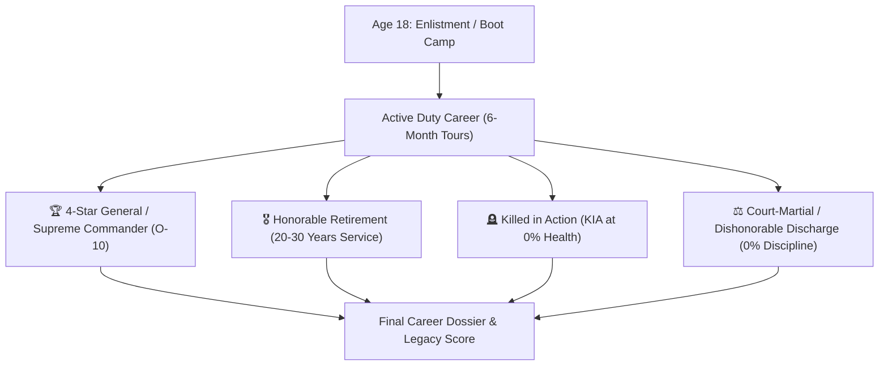
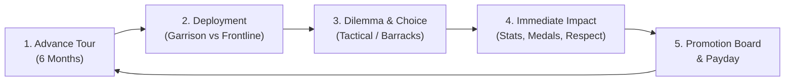
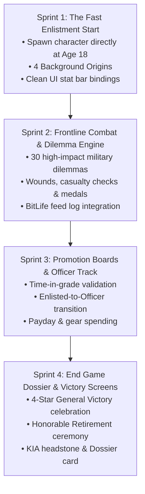

# ARMY LIFE SIMULATOR: Game Blueprint & Implementation Plan

> **Genre:** Military Life Simulation RPG  
> **Inspirations:** *BitLife* meets *Band of Brothers*, *Papers, Please*, and *Reigns*.  
> **Platform:** PC (Steam) & Mobile (iOS / Android)  
> **Engine:** Unity 6 (URP 2D)  
> **Guiding Principle:** Fast, playable, high-stakes military drama from the very first click.

---

## 🎯 1. The End Point & Win/Loss Conditions

Every playthrough represents a complete military career run. A run concludes with an **After-Action Career Dossier** presenting the soldier's final rank, years of service, combat tours survived, medals awarded, and ultimate legacy.

### 1.1 The 4 Definitive End Points

| Outcome | Classification | Condition | Outcome Screen |
| :--- | :--- | :--- | :--- |
| **"The 4-Star Legend"** | 🏆 **Supreme Victory** | Reach the highest rank (General of the Army / O-10) | Grand military parade, historical hall of fame, maximum legacy score. |
| **"The Honorable Veteran"** | 🎖️ **Career Victory** | Complete 20+ years of active duty and choose honorable retirement | Veteran retirement ceremony, pension awarded, medal display case. |
| **"Killed in Action (KIA)"** | 🪦 **Tragic / Heroic End** | Health reaches 0% during a combat engagement | Posthumous Purple Heart / Medal of Honor, fallen soldier epitaph. |
| **"Dishonorable Discharge"** | ⚖️ **Defeat** | Discipline hits 0%, or convicted of desertion/mutiny | Court-martial tribunal verdict, loss of rank and benefits, exile/imprisonment. |

---

## 🔄 2. The Core Moment-to-Moment Loop

Turns are paced in **6-Month Semiannual Tours** (Spring/Summer Tour & Fall/Winter Tour). Each turn takes **15 to 30 seconds** of snappy decision-making.

1. **Advance Tour**: Time ticks forward 6 months.
2. **Deployment Roll**: 
   * **Garrison Duty**: Base training, weapons qualifications, barracks inspections, off-duty gambling, CO politics.
   * **Frontline Combat**: High-risk combat zone (Trench raid, urban siege, ambushes, desert patrol).
3. **High-Impact Dilemma**: A 2-sentence scenario with 2 or 3 distinct choices (Risk vs. Safety, Duty vs. Survival, Squad Comrades vs. Career Advancement).
4. **Immediate Consequence**: Stats update, feed logs the story event, wounds or medals are granted.
5. **Promotion Board & Payday**: Collect military salary. If Merit and Time-in-Grade requirements are met, face the promotion board to earn the next rank.

### 2.1 Voluntary Extended Frontline Tours & +10% Pay Bonus
* **Voluntary Tour Extension**: Players can choose to remain deployed in active combat zones longer than the standard 6-month tour instead of returning to garrison base for rest.
* **Pay Continuity**: Standard base pay and combat hazard pay ($450/mo) continue as normal during the tour.
* **The +10% Continuous Frontline Bonus**: If a soldier stays continuously deployed on the battlefield for **longer than 1 year** (2+ consecutive semesters), their **Total Pay increases by 10%**.
  * This bonus is calculated as a direct +10% boost on total pay and stacks independently without affecting or overriding any rank promotions or standard raises.

---

## 📊 3. The 5 Core Soldier Stats

All complex multi-tier math and continuous nutrient burn systems are replaced with 5 clean, intuitive meters:

* **Health (0–100%)**: Physical condition. Wounds reduce health; rest, field medics, or hospital leave restores it. Hitting 0% results in **KIA**.
* **Morale (0–100%)**: Psychological stamina and will to fight. Low morale triggers battle fatigue, depression, or panic under fire.
* **Discipline (0–100%)**: Standing with commanding officers and military police. High discipline qualifies for officer track (OCS); zero discipline results in the brig or **Court-Martial**.
* **Combat Skill (0–100%)**: Marksmanship, tactical awareness, and hand-to-hand proficiency. Directly determines success rates in life-or-death battlefield encounters.
* **Cash ($)**: Savings from monthly salary, combat pay, hazard stipends, or gambling. Spent on better field kit, bribes, squad drinks, or sending money home to family.

---

## 🪖 4. The Rank Progression Ladder

A clear, satisfying ladder of progression where each promotion unlocks higher pay, greater authority, and command decisions:

### Enlisted Path
1. **Recruit (E-1)** — Basic training recruit ($150/mo).
2. **Private (E-2)** — Standard line infantry grunt ($300/mo).
3. **Private First Class (E-3)** — Experienced rifleman ($450/mo).
4. **Corporal (E-4)** — Fireteam leader, first leadership responsibilities ($650/mo).
5. **Sergeant (E-5)** — Squad leader, manages squad morale and discipline ($900/mo).
6. **Staff Sergeant (E-6)** — Platoon sergeant, battlefield tactician ($1,250/mo).
7. **Master Sergeant (E-7)** — Senior non-commissioned officer ($1,800/mo).
8. **Sergeant Major (E-9)** — Highest enlisted authority; advisor to the commander ($2,600/mo).

### Officer Commission Track (Via 2-Year War Academy)
> **The Imperial War Academy**: A prestigious 2-year (4-semester) officer commissioning program:
> * **Limited Seats & Admission Board**: Requires 55% Discipline and 55% Physical Readiness.
> * **$50,000 Tuition / 9% Loan**: Pay upfront cash or take a 9% annual interest loan with monthly deduction of minimum 10% of salary (customizable).
> * **Top 10% Special Forces Pathway**: In Year 2, cadets with top 10% standing (score >= 90%) qualify to enter elite 1-year Special Forces selection!
> * **Direct O-1 Commission**: Graduating the 2-year academy directly commissions the cadet as a **2nd Lieutenant (O-1)**!

1. **2nd Lieutenant (O-1)** — Platoon commander ($3,800/mo).
2. **1st Lieutenant (O-2)** — Executive officer ($4,500/mo).
3. **Captain (O-3)** — Company commander ($5,800/mo).
4. **Major (O-4)** — Battalion operations officer ($7,200/mo).
5. **Lieutenant Colonel (O-5)** — Battalion commander ($9,500/mo).
6. **Colonel (O-6)** — Regimental commander ($12,000/mo).
7. **Brigadier General (O-7)** — Brigade commander ($16,000/mo).
8. **Major General (O-8)** — Division commander ($22,000/mo).
9. **Lieutenant General (O-9)** — Corps commander ($28,000/mo).
10. **General of the Army (O-10)** — Supreme Commander ($35,000/mo).

### ⚡ Special Forces Program (Elite Commando Operations)
* **Training**: 1-Year Qualification Course (2 Semesters).
* **Two Pathways**:
  1. **Academy Year 2 Top 10%**: Academic honors cadets invited directly to selection.
  2. **Enlisted CO Recommendation**: High-performing enlisted soldiers (CO Favor >= 70%, Merit >= 60%) recommended directly by their commander.
* **Perks & Hazards**:
  * **+$800 / mo Elite Hazard Stipend** on top of all other earnings.
  * **Higher Lethality Risk**: Black-ops missions and night raids carry elevated casualty/mortality rates.
  * **Experience Scaling**: Gathers enhanced combat skill, leadership, and operational experience as rank climbs.

---

## 🏅 5. Military Decorations & Medals

Medals are earned through specific heroic deeds during frontline dilemmas:
* **Imperial Wound Star / Purple Heart**: Awarded for surviving major shrapnel or gunshot wounds in combat.
* **Combat Infantry Badge**: Awarded after surviving your first direct enemy engagement.
* **Bronze Star of Valor**: Awarded for rescuing wounded comrades under heavy enemy fire.
* **Silver Vanguard Cross**: Awarded for single-handedly neutralizing an enemy bunker or sniper nest.
* **Distinguished Service Cross**: Awarded for holding an overrun defensive position against superior forces.
* **The Grand Imperial Star / Medal of Honor**: The nation's highest military decoration for extraordinary battlefield heroism.

---

## 🛠️ 6. Implementation Roadmap

### Phase Summary
1. **Phase 1 (Immediate Playability)**: Start at Age 18 in boot camp. Remove the 0-18 childhood phase and cultivation code. Wire the 5 stats directly to the existing HUD sliders.
2. **Phase 2 (Dynamic Dilemmas & Combat)**: Connect frontline and barracks dilemmas with real risk/reward and medal awards.
3. **Phase 3 (Progression & Promotion)**: Promotion board checks, salary calculation, and equipment purchasing.
4. **Phase 4 (End of Service)**: The Career Dossier screen showing final medals, battles, cause of death/retirement, and legacy score.
