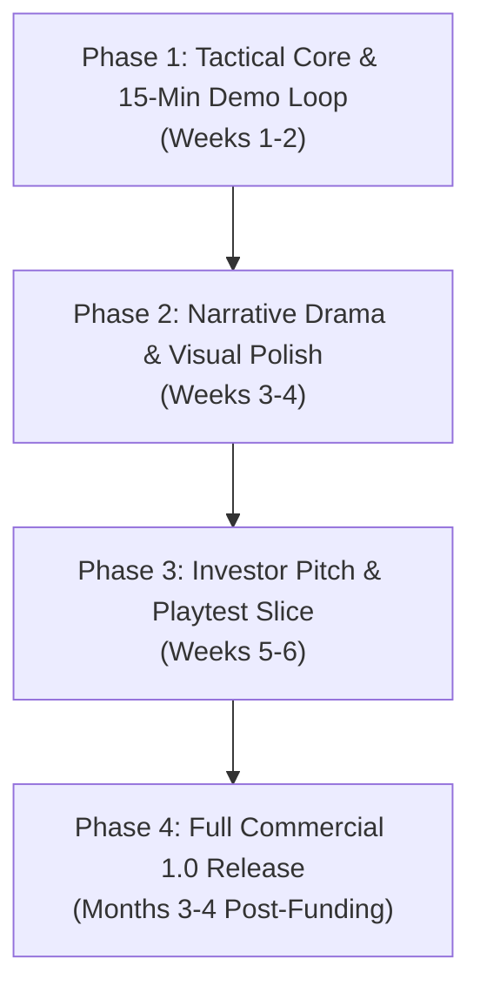

# VALERIAN VANGUARD: Game Endpoint & Phased Investor Roadmap

> **Target Identity:** An Imperial Military Life Simulation RPG  
> **Comps:** *BitLife* meets *Warhammer 40,000: Imperial Guard*, *Suzerain*, and *Papers, Please*.  
> **Platforms:** PC (Steam: $9.99–$12.99) & Mobile (iOS / Android F2P)

---

## 1. The Game Endpoint: What is the Final Game?

### 1.1 The High Concept
The player is born into the brutal, diesel-aether war machine of the **Valerian Empire**. From a commoner grunt in the industrial slums to a scion of a noble martial dynasty, the player lives life turn-by-turn (6 months per semester). 

Will they:
* Score high on national exams and enter the **Imperial War Academy** as an aristocratic officer?
* Get conscripted into the frontline trench infantry, surviving heavy bombardment and earning military honors?
* Pursue civilian trade, enduring a 50% municipal tax while funding their family’s martial rise?
* Die gloriously in battle, leaving medals, inheritance, and a legacy to their child in **Generation 2**?

### 1.2 How It Looks and Feels (The Aesthetic)
1. **Visual Style**:
   * **Color Palette**: Tactical Dark Slate (`#101418`), Deep Navy (`#18202A`), Imperial Gold (`#FFD700`), Blood Crimson (`#FF4444`), and Aether Cyan (`#00D4FF`).
   * **Paperwork & Bureaucracy Aesthetic**: Official military documents featuring red ink stamps (`[DRAFTED]`, `[COMMENDED]`, `[COURT MARTIAL]`, `[HONORABLY DISCHARGED]`) and wax seals.
   * **The Service Jacket (Life Dossier)**: Instead of a wall of text, the player sees:
     * Brass rank chevrons and sleeve patches indicating their current rank (Private E-1 to Warmaster General).
     * A visual **Medal Rack** displaying ribbon bars and medals earned in combat.
     * Battle scars and status badges (`[Decorated Veteran]`, `[One-Eyed Marksman]`, `[Shellshocked]`).
2. **Audio & Atmosphere**:
   * Heavy mechanical button clicks and typewriter-style text cadence.
   * Atmospheric military soundtrack: muted snares, brass horns, and distant artillery rumbles during wartime deployments.
3. **The Core Moment-to-Moment Interaction**:
   * Turns take **10 to 20 seconds**.
   * Reading is kept punchy: strictly adhering to the **Rule of 2 Sentences** for dilemmas.
   * Every choice forces real tension: **Risk vs. Reward** (Morale vs. Cash, Duty vs. Survival, Squad vs. Promotion).

---

## 2. The Core 5-Button Gameplay Loop

The interface is anchored by **5 persistent bottom navigation buttons**:

```
+---------------------------------------------------------------+
|                      [HEADER: Ethan Vance]                    |
| Age 18.5 | Year 2026 S2 | Private (E-1) | Net: +$360/mo (40% Tax)|
+---------------------------------------------------------------+
|                                                               |
|                   INTERACTIVE BITLIFE FEED                     |
|                                                               |
|   [FRONT TOUR] Artillery barrage hits Sector 7 bunker.        |
|   You drag Sergeant Miller to safety under heavy fire!        |
|   +15 Merit | Miller is now your Sworn Battlefield Comrade.   |
|                                                               |
+---------------------------------------------------------------+
|  HEALTH [90%]  |  FITNESS [75%]  |  COMBAT [60%]  | INTEL [50%]|
+---------------------------------------------------------------+
|  [LIFE]  |  [FINANCE]  |  [GROW UP (+)]  |  [RELATIONS]  | [ACT]  |
+---------------------------------------------------------------+
```

1. **`[LIFE]`**: View personal profile, physical health, medals rack, rank insignia, military disciplinary record, and dynastic traits.
2. **`[FINANCE]`**: Manage liquid cash, send family remittances, buy Imperial War Bonds, view 40% military war tax or 50% civil tax deductions, and repay college tuition debt.
3. **`[GROW UP (+)]` / `[AGE (+)]`**: The beating heart of the game. Advances the clock by 6 months, processes pay/taxes, triggers life events, checks promotions, and rolls wartime dilemmas.
4. **`[RELATIONS]`**: Manage relationships with parents, martial siblings, squadmates, commanding officers, and noble clan elders.
5. **`[ACTIVITIES]`**: Context-sensitive actions based on career stage:
   * *Youth (0–18)*: Body tempering, academy exam prep, sparring, district odd jobs.
   * *Cadet / Student*: Study tactics, flight simulator, night patrols, duel peer rivals.
   * *Active Military*: Weapons range, weapon maintenance, squad gambling, challenge promotion board, volunteer for frontline hazardous duty.
   * *Civilian*: Career overtime, trade licensing, municipal petitions, night school.

---

## 3. Phased Implementation Roadmap



---

### Phase 1: Tactical Core & 15-Minute Replay Loop (Weeks 1–2)
**Goal:** Create a rock-solid, bug-free core loop where a player can play one full military life in 15 minutes.

- [x] **Tax & Economics Balance**:
  - 40% Mandatory Imperial War Tax for active military duty.
  - 50% Municipal Tax for civilian career tracks.
  - Cadet stipends tax-exempt; recruit boot camp (6 mo) unpaid.
- [x] **Responsive UI & Layering**:
  - Modal sibling depth (`SetAsLastSibling()`) so all 5 modals open instantly without obstruction.
  - Text clipping via `RectMask2D` on feed container to prevent text overflow or click-blocking.
- [ ] **Tight Dilemma Deck (35 High-Impact Scenarios)**:
  - 10 Youth & Exam Dilemmas (Age 10–18): Cheating on military exams, defending siblings, noble patron favors.
  - 15 Frontline Wartime Dilemmas (Age 18–30): Trench artillery, sniper encounters, civilian hostages, insubordination vs following suicidal orders.
  - 10 Base & Garrison Politics Dilemmas: Rivalry with aristocratic lieutenants, black market bootleg supply theft, promotion board interviews.
- [ ] **Promotion Board System Integration**:
  - Time-in-grade validation (E-1: 6mo, E-2: 1yr, E-3: 1.5yr).
  - Clean promotion celebration screen when advancing rank.

---

### Phase 2: Narrative Drama & Visual Polish (Weeks 3–4)
**Goal:** Replace dry numeric stat-swapping with permanent human drama, visual medals, and physical consequences.

1. **Reputation & Story Trait System**:
   - Give soldiers permanent story tags based on event choices:
     - `[Decorated Hero]`: +20% promotion board favor, respect from enlisted troops.
     - `[Shellshocked]`: -10% composure in ambushes, requires apothecary nerve draughts.
     - `[One-Eyed Veteran]`: Lost eye in combat deployment; unlocks unique intimidation dialog.
     - `[Sworn Comrade: Miller]`: Miller assists during court-martial trials.
     - `[Aristocrat's Enemy]`: Noble officers block easy promotions.
2. **Visual Medals & Paperwork Assets**:
   - Implement **Medal Rack** in `LifeModal`:
     - *Imperial Wound Badge* (for surviving fatal wounds).
     - *Iron Vanguard Star* (for volunteering for frontline hazard duty).
     - *Crown Order of Merit* (for exceptional exam and tactical performance).
   - Implement visual bureaucratic stamps on event resolution:
     - Stamped in bold red/gold text: `[APPROVED]`, `[DRAFTED]`, `[PROMOTED]`, `[CASUALTY REPORT]`.
3. **Sound Effects Pass**:
   - Heavy tactile UI clicks for bottom buttons.
   - Distinctive typewriter audio for incoming feed reports.
   - Dramatic stingers for wartime breakthroughs, promotions, or death.

---

### Phase 3: The Investor Pitch & Playtest Slice (Weeks 5–6)
**Goal:** Assemble the playable demo, generate proof of retention, and create the pitch deck for publishers and investors.

1. **Multi-Generational Dynasty & Succession**:
   - When a soldier dies or retires, their accrued cash vault, noble title, and heirloom medal box pass to their designated heir.
   - Player immediately begins Life #2 with higher starting advantages (The "One More Run" addiction factor).
2. **20-Player Playtest & Retention Verification**:
   - Host build on itch.io (private or unlisted).
   - Collect session metrics:
     - Average session playtime (Target: > 18 minutes).
     - Replay rate / Life 2 start rate (Target: > 60%).
3. **Publisher / Investor Pitch Deck (10 Slides)**:
   - *Slide 1:* Title & Tagline (*The Gritty Military Life Simulator*).
   - *Slide 2:* The Market Opportunity (*BitLife's 100M+ downloads + Warhammer 40k's passionate demographic*).
   - *Slide 3:* Core Gameplay Pillars (Fast Turns, High Stakes, Dynastic Succession).
   - *Slide 4:* 15-Minute Playable Vertical Slice link.
   - *Slide 5:* Playtester Retention Metrics (Proof that players love it).
   - *Slide 6:* Monetization Model (Steam Premium + Mobile cosmetic battle passes).
   - *Slide 7:* Content Roadmap (Full 10-rank officer tree, 3 warring empires).
   - *Slide 8:* Production Budget & Schedule ($50k–$80k for complete audio, custom portraits, and localization).
   - *Slide 9:* Team & Capabilities.
   - *Slide 10:* The Ask (Funding terms & milestones).

---

### Phase 4: Full Commercial 1.0 Release (Months 3–4 Post-Funding)
**Goal:** Expand the vertical slice into a massive, commercially competitive PC and mobile game.

1. **Three-Nation Continental Warfare**:
   - Fight for the **Valerian Empire** (feudal mechanized imperial army), **Iron Federation** (cybernetic industrial democracy), or **Ouroboros Dominion** (mutated beast warlords).
2. **Commissioned Officer & High Command Track**:
   - Advance beyond Enlisted (E-1 to E-9) into Officer ranks (Second Lieutenant O-1 up to Warmaster General O-10).
   - Command platoons, artillery batteries, and continental airships; allocate ammo and decide operational battle plans.
3. **Dynastic Marriage & High Society**:
   - Arrange marriages with noble houses, negotiate dowries, purchase imperial manor estates, and participate in imperial court politics.
4. **Platform Integration**:
   - Steam Achievements, Cloud Saves, Steam Deck full compatibility.
   - Localization into 6 languages (English, German, French, Simplified Chinese, Russian, Spanish).

---

## 4. Pitch Summary Cheat Sheet

| Question | Winning Answer |
| :--- | :--- |
| **What is the game?** | A turn-based imperial military life simulator where commoners and nobles survive frontline trench wars and dynastic politics. |
| **Why is it fun?** | Fast 15-second turns, ruthless dilemmas, permanent battle scars/medals, and generational succession. |
| **Who will buy it?** | Fans of *BitLife*, *Warhammer 40k*, *Suzerain*, *Reigns*, and *Crusader Kings*. |
| **How long to invest-ready demo?** | 4 to 6 weeks. |
| **How long to full commercial release?** | 3 to 4 months following funding. |
